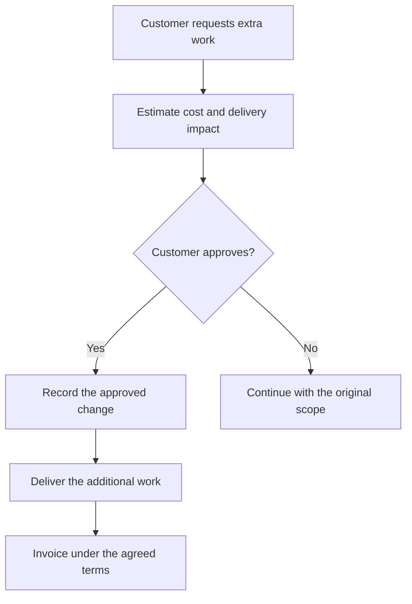

# Worked examples

All scenarios and numbers below are illustrative. These examples demonstrate clarity, not measured performance improvements.

## Client scope-change message

Before:

> In light of the recently surfaced supplementary requirements, a recalibration of the commercial arrangement may be warranted.

After:

> The new reporting dashboard adds work beyond our agreement. It will cost an additional $800 and take three working days. Please approve the change before we start.

Why it works: names the change, cost, timing, and required action. In real use, confirm those details rather than inventing them.

## Technical explanation: webhooks

Before:

> Webhooks facilitate event-driven interoperability through asynchronous payload delivery to predefined endpoints.

After:

> A webhook sends a message to another app when an event happens. For example, a payment system can notify your app when a customer pays. Your app receives the message at a URL you configure.

Necessary qualification: delivery can fail or repeat. A production integration should verify the sender and handle retries without processing the same event twice.

## Social post: API rate limits

Before:

> Navigating the complexities of API consumption requires a robust understanding of throughput constraints to optimize operational efficiency.

After:

> Your CRM integration can fail if it sends requests too quickly.
>
> An API rate limit sets how many requests you can send within a period. Suppose an API allows 100 requests per minute. Sending 150 in that minute may cause some requests to be rejected.
>
> Check the provider's limits. Spread requests out and follow its retry instructions.

Why it works: starts with a concrete problem, defines the term, and gives an action. The numerical limit is hypothetical; actual provider rules vary.

## Diagram: approving extra work

This illustrative workflow separates requesting work from approving it. Actual billing may occur before delivery if the agreement requires it.

## Interactive page brief: profit impact

Goal: show how extra hours affect profit on a fixed-fee project.

Inputs: project fee, planned hours, extra hours, and hourly delivery cost.

Calculation: profit = project fee - ((planned hours + extra hours) x hourly delivery cost).

With a $5,000 fee, 40 planned hours, and a $50 hourly cost, illustrative profit is $3,000. Adding 10 hours reduces it to $2,500. This model excludes tax and other costs.

A useful page lets the reader adjust extra hours and see the result. Label the assumptions and validate inputs. A static paragraph is enough if the reader only needs this one calculation.

## Video storyboard: scope changes

| Time | Visual | Narration |
| --- | --- | --- |
| 0-10s | Original project agreement | A project starts with agreed work, a price, and a delivery date. |
| 10-25s | Customer adds a dashboard request | A new request can add time and cost. Estimate its effect before starting. |
| 25-40s | Approval decision with two paths | Ask the customer to approve the change. If they decline, continue with the original scope. |
| 40-55s | Approved change attached to agreement | Record the approval and update the plan. Bill under the agreed terms. |
| 55-60s | Request -> estimate -> approval -> work | Make the change clear before you do the extra work. |

This is a storyboard, not a rendered video. Add captions and verify timing during production.
